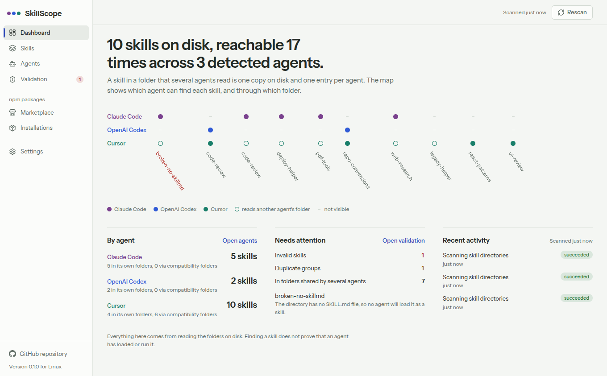
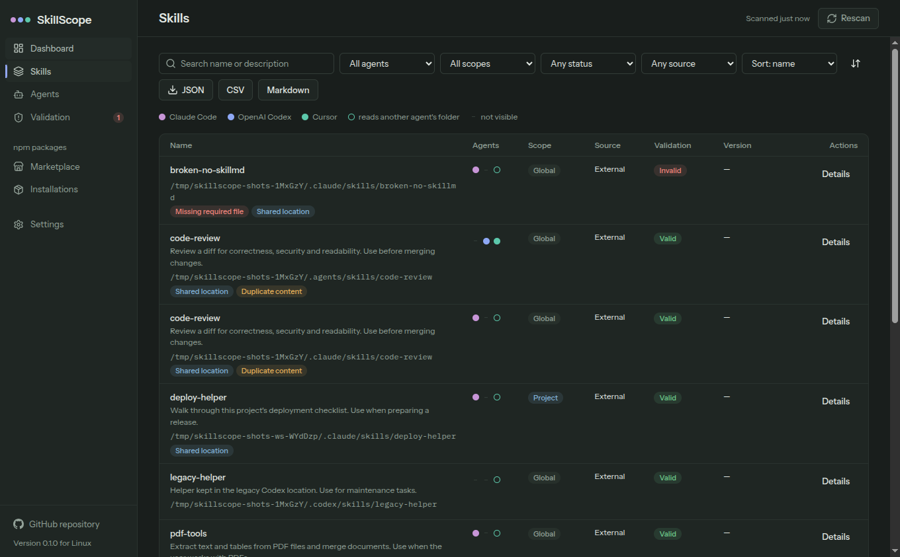
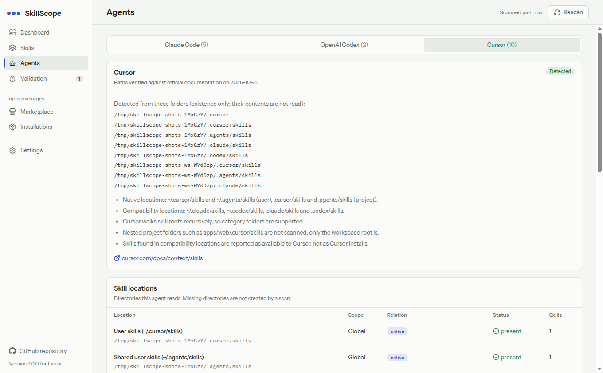

# SkillScope

SkillScope is a desktop app for Linux and Windows that shows which agent skills are on your
computer, which coding agents can reach each one, and installs new skills from npm into
**Claude Code**, **OpenAI Codex** and **Cursor**, each independently.



> **Detected is not the same as loaded.** SkillScope reads the skill folders on disk. Finding a
> skill there does not prove that an agent has loaded or run it.

## What it does

- **One inventory for three agents.** It scans the documented user, project and system skill
  folders for each agent ([supported paths](docs/supported-paths.md)) without changing anything.
- **Shows reach, not just files.** A skill in `~/.agents/skills` is one folder that both Codex
  and Cursor read. SkillScope shows it once, with two availability entries, and explains why each
  agent can see it (its own folder, or a compatibility folder such as Cursor reading
  `~/.claude/skills`).
- **Validates skills** against the Agent Skills format: missing `SKILL.md`, frontmatter errors,
  name and description rules, missing references, links that leave the skill and unsafe symlinks.
  Agent-specific differences are reported as compatibility warnings. Skills are never edited.
- **Finds duplicates:** identical copies in different folders and the same name with different
  content.
- **Installs from npm safely.** Integrity is verified, archives are unpacked in memory with
  traversal, links and devices rejected, files are staged privately and validated, and **package
  scripts are never run**. You pick Claude Code, Codex, Cursor or any combination, at global or
  project scope, and review conflicts before anything is written.
- **Manages what it installed.** Per-agent receipts with SHA-256 checksums, backups, update
  checks, rollback of failed or interrupted installs, and removal that deletes only unchanged
  files SkillScope owns.
- **Exports** the inventory as JSON, CSV or Markdown ([examples](docs/examples)).
- Light and dark themes, offline viewing of the last scan, no account, no telemetry.

|                                                          |                                                      |
| -------------------------------------------------------- | ---------------------------------------------------- |
|  |  |

## Install

Download the installer for your platform from the
[releases page](https://github.com/ammarqaisar11a55/SkillScope-Cross-Agent-Skill-Manager/releases):

- **Linux:** `SkillScope-<version>-linux-x86_64.AppImage` (no install needed) or
  `SkillScope-<version>-linux-amd64.deb`
- **Windows:** `SkillScope-<version>-windows-x64-setup.exe` (per-user, no administrator rights)

Check downloads against `SHA256SUMS.txt`. The Windows installer is not code signed yet. See
[docs/release.md](docs/release.md) for installation, upgrade and uninstall details. No separate
Node.js or npm installation is needed.

## Use

1. Open SkillScope. It scans your skill folders on start.
2. **Dashboard:** the reach map shows every skill (columns) against every agent (rows): a filled
   dot is the agent's own folder, a ring is a folder it also reads.
3. **Skills:** search and filter, open a skill to see its files, `SKILL.md`, validation results
   and why each agent can see it.
4. **Settings:** choose a project workspace to include project-level skills, or add custom skill
   folders.
5. **Marketplace:** search npm, inspect a package, choose agents and scope, review and confirm.
6. **Installations:** check for updates, update, remove or restore backups of skills installed by
   SkillScope.

## Publishing skills for SkillScope

Add an `agent-skill.json` to your npm package to declare which folders are skills and which
agents they target. See [docs/npm-skill-packages.md](docs/npm-skill-packages.md). This manifest is
a SkillScope convention, not an npm or agent standard.

## Documentation

- [Architecture](docs/architecture.md) and [decision record](docs/adr/0001-architecture-and-tooling.md)
- [Supported agent paths](docs/supported-paths.md) (verified 2026-10-21)
- [npm skill package format](docs/npm-skill-packages.md)
- [Security and privacy](docs/security.md)
- [Development](docs/development.md)
- [Packaging and releases](docs/release.md) and [release notes](docs/release-notes.md)

## Known limitations

- Windows is verified by CI; development and manual testing were done on Linux.
- Only the selected workspace root is scanned for project skills (no nested project folders, no
  Codex parent-directory walk, no Claude Code plugin skills).
- The Claude Code enterprise skill folder on Windows is inferred, not documented.
- Authenticated npm registries are not supported.

## Development

```bash
npm ci --ignore-scripts
node node_modules/electron/install.js
npm run dev        # run the app
npm run check      # typecheck, lint, format, tests
```

See [docs/development.md](docs/development.md).

## License

[MIT](LICENSE) © 2026 Muhammad Ammar Qaisar
